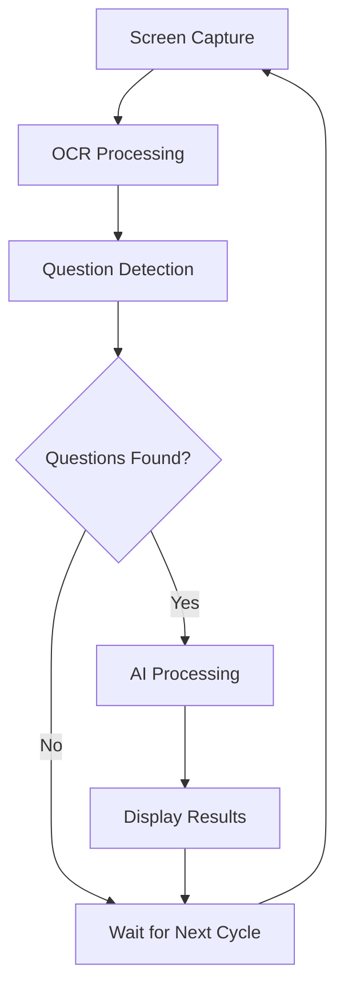

# AI-Powered Screen Reader

An intelligent screen reader that automatically captures your screen every 30 seconds, detects questions (especially MCQs), and provides AI-generated answers using Claude or ChatGPT. Perfect for online exams, quizzes, and educational content.

## 🚀 Features

- **🔄 Automated Screen Capture**: Captures screen content every 30 seconds (configurable)
- **👁️ OCR Text Extraction**: Extracts text from screenshots using advanced Tesseract OCR
- **🧠 Smart Question Detection**: Intelligently identifies questions, MCQs, and various query patterns
- **🤖 AI Integration**: Uses Claude (Anthropic) or ChatGPT (OpenAI) for accurate answers
- **💻 Real-time GUI**: User-friendly interface with live updates and tabbed views
- **⚙️ Highly Configurable**: Customizable intervals, screen regions, AI preferences, and more
- **📊 Performance Monitoring**: Built-in logging and statistics tracking
- **🔧 Component Testing**: Comprehensive testing suite for all components

## 📋 Prerequisites

### Required Software
1. **Python 3.8+**: Download from [python.org](https://python.org)
2. **Tesseract OCR**:
   - **Windows**: Download from [GitHub releases](https://github.com/tesseract-ocr/tesseract/releases)
   - **macOS**: `brew install tesseract`
   - **Linux**: `sudo apt-get install tesseract-ocr`

### API Keys (at least one required)
- **OpenAI API Key**: Get from [OpenAI Platform](https://platform.openai.com/api-keys)
- **Anthropic API Key**: Get from [Anthropic Console](https://console.anthropic.com/)

## 🛠️ Quick Installation

### Windows (Automatic)
1. Run `install.bat`
2. Follow the prompts
3. Edit `.env` file with your API keys

### Manual Installation
1. Install Python dependencies:
   ```bash
   pip install -r requirements.txt
   ```
2. Create configuration:
   ```bash
   copy .env.example .env    # Windows
   cp .env.example .env      # macOS/Linux
   ```
3. Edit `.env` with your API keys:
   ```env
   OPENAI_API_KEY=your_openai_key_here
   ANTHROPIC_API_KEY=your_anthropic_key_here
   TESSERACT_PATH=C:\Program Files\Tesseract-OCR\tesseract.exe
   ```

## 🧪 Testing

Test all components before running:
```bash
python test_components.py
```

## 🚀 Usage

1. **Start the application**:
   ```bash
   python main.py
   ```

2. **Configure settings** in the GUI:
   - Set refresh interval (5-300 seconds)
   - Choose AI provider (Claude/OpenAI)
   - Adjust other preferences

3. **Click "Start Reading"** to begin automatic scanning

4. **Monitor results** in real-time:
   - **Extracted Text**: OCR results from your screen
   - **Detected Questions**: Identified questions and MCQs
   - **AI Answers**: Generated answers with explanations

## 🎯 Perfect For

- **Online Exams & Quizzes**: Get instant answers to MCQs
- **Educational Content**: Understand complex questions
- **Study Sessions**: Quick explanations and answers
- **Research**: Extract and analyze text from any screen content
- **Accessibility**: Assist users with reading difficulties

## 🔧 Advanced Configuration

The application supports extensive customization through `config.py`:

- **Screen Regions**: Capture full screen or specific areas
- **OCR Settings**: Fine-tune text extraction accuracy
- **Question Patterns**: Add custom question detection rules
- **AI Models**: Choose between different AI models
- **Performance**: Adjust processing intervals and timeouts

## 📊 How It Works



1. **Screen Capture**: Takes high-quality screenshots
2. **OCR Processing**: Extracts text with preprocessing for accuracy
3. **Question Detection**: Uses regex and NLP to identify questions
4. **AI Processing**: Sends formatted questions to AI APIs
5. **Display Results**: Updates GUI with answers and explanations

## 📁 Project Structure

```
screen-reader/
├── main.py                 # Main application entry point
├── config.py              # Configuration management
├── screen_capture.py      # Screen capture functionality
├── ocr_processor.py       # OCR text extraction
├── question_detector.py   # Question detection logic
├── ai_integration.py      # AI API integration
├── gui.py                 # GUI interface
├── automation_engine.py   # Main automation logic
├── test_components.py     # Component testing
├── requirements.txt       # Python dependencies
├── .env.example          # Environment template
├── README.md             # This file
├── SETUP_GUIDE.md        # Detailed setup instructions
└── logs/                 # Application logs (created automatically)
```

## 🔍 Supported Question Types

The system can detect and process various question formats:

- **Multiple Choice Questions (MCQs)**:
  ```
  What is the capital of France?
  A) London
  B) Berlin
  C) Paris
  D) Madrid
  ```

- **Direct Questions**: "What is...?", "How does...?", "Why is...?"
- **Selection Questions**: "Which of the following...", "Choose the correct..."
- **True/False Questions**: "True or False: ..."
- **Numbered Questions**: "1. What is...", "Question 2: ..."

## 🛠️ Troubleshooting

### Common Issues

| Issue | Solution |
|-------|----------|
| "Tesseract not found" | Install Tesseract OCR and add to PATH |
| "No API key found" | Add valid API keys to `.env` file |
| "No text extracted" | Check screen contrast and text visibility |
| "AI provider not available" | Verify API key validity and internet connection |

### Performance Tips

- **Better OCR**: Use high contrast, avoid small fonts
- **Faster Processing**: Increase refresh interval, use smaller screen regions
- **Improved Detection**: Use clear question formatting, avoid overlapping windows

## 📈 System Requirements

- **OS**: Windows 10+, macOS 10.14+, or Linux
- **RAM**: 4GB minimum, 8GB recommended
- **Python**: 3.8 or higher
- **Internet**: Required for AI API calls
- **Screen**: Any resolution (higher resolution = better OCR)

## 🔒 Security & Privacy

- **API Keys**: Stored locally in `.env` file (never shared)
- **Screen Data**: Processed locally, only questions sent to AI
- **Logs**: Stored locally in `logs/` directory
- **No Data Collection**: No telemetry or usage tracking

## 📝 License

This project is open source. Feel free to modify and distribute according to your needs.

## 🤝 Contributing

Contributions are welcome! Areas for improvement:
- Additional question detection patterns
- Support for more AI providers
- Enhanced OCR preprocessing
- Mobile/tablet support
- Multi-language support

## 📞 Support

For issues and questions:
1. Run `python test_components.py` to diagnose problems
2. Check `logs/screen_reader.log` for detailed error information
3. Review the `SETUP_GUIDE.md` for detailed instructions
4. Ensure all prerequisites are properly installed

---

**⚠️ Disclaimer**: This tool is for educational and accessibility purposes. Please respect academic integrity policies and terms of service of online platforms.
